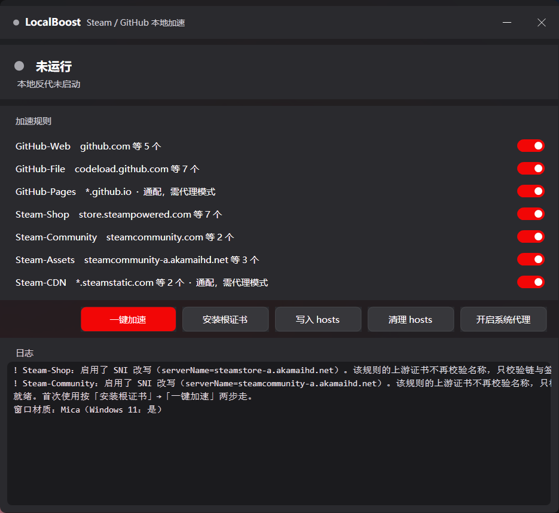

# LocalBoost

Windows 本地加速工具，用 .NET 9 + YARP 实现。只处理 Steam 与 GitHub：把这些域名指向本机，
由本机反代挑选可用出口 IP 后转发。

带图形界面，也保留完整命令行。

> 与 Watt Toolkit 的关系：代码独立编写，未复制其源码。域名分组与几处出口改写参数
> 参考了该项目的公开做法并自行实测确认，详见文末「参考与致谢」。
> 本项目与 Valve、GitHub, Inc.、BeyondDimension 均无关联。



---

## 它会在系统里改什么

本地 HTTPS 反代需要动三处系统设置。都有完整回滚，但你应该先知道：

| 改什么 | 具体动作 | 怎么回滚 |
|---|---|---|
| hosts | 在规则域名处插入一段托管区块，指向 `127.0.0.1` | `hosts remove`，只删托管区块，原有条目不动 |
| 计算机级根证书 | 生成一张本地根 CA，装进 `LocalMachine\Root` | `cert remove` |
| 系统代理（仅主动开启时） | `AutoConfigURL` 指向本地 PAC | `proxy remove`，停止加速时也会自动还原 |

**关于根证书**：私钥在本机，但它写入的是计算机级信任库，此后这台机器上所有用户、
所有程序的 HTTPS 都可能被这把密钥解开。这是本地 MITM 方案的固有代价，不是实现缺陷。

私钥存放在 `%LOCALAPPDATA%\LocalBoost\`，口令与 PKCS12 主体都经 DPAPI 按当前账户加密，
目录 ACL 已断开继承。但同一账户下的其它进程仍有办法使用它，这是文件加密解决不了的。

所以：

- 只在**自己的电脑**上用。共享电脑、公司电脑不要装。
- 不用了执行 `cert remove` 和 `hosts remove`（界面上也有对应按钮）。
- 不愿意系统里出现第三方根证书，就**只用代理模式** —— 它走 CONNECT 盲隧道，
  端到端加密不经过本程序，完全不需要装证书。

---

## 两种加速模式

| | hosts + 本地反代 | 本地代理 + PAC |
|---|---|---|
| 接管方式 | hosts 指向 `127.0.0.1`，按 SNI 动态签证书 | 系统代理指向本地 PAC，PAC 只导入规则域名 |
| 需要根证书 | 需要 | **不需要** |
| 覆盖范围 | 只能表达确切域名 | 能覆盖通配域名（`*.github.io` 等） |
| 生效对象 | 全系统 | 只对遵循系统代理的程序生效 |
| 能改写 SNI | 能（`serverName` 字段） | 不能（拿不到明文） |
| HSTS 干扰 | 会遇到 | 不会 |

两者可同时开。只想要通配域名又不想装证书，代理模式就够。

代理模式收到 `CONNECT host:443` 后按优选 IP 建裸 TCP，之后只搬运密文，
程序全程看不到明文。代理只监听 `127.0.0.1`，只接管规则内域名，不会成为开放代理。

---

## 用法

### 图形界面

跑一次 `publish.cmd`，双击产出的 `LocalBoost.exe`：

1. 勾选要加速的规则（默认六组全开）
2. 点「安装根证书」—— 会请求管理员权限（只用代理模式可跳过）
3. 点「一键加速」—— 写入 hosts、启动本地反代与本地 HTTP 代理
4. 需要覆盖通配域名就开「系统代理」

程序要求管理员权限启动（改 hosts、监听 443、写计算机级信任库都需要），每次会弹 UAC。
关窗口不等于退出，会缩到托盘；真正退出用托盘右键菜单。

### 命令行

```bash
LocalBoost.exe run              # 启动反代 + 本地代理（前台，Ctrl+C 停止）
LocalBoost.exe probe github.com # IP 优选诊断，不用先装证书
LocalBoost.exe rules            # 看规则表
LocalBoost.exe cert install     # 装根证书到计算机信任库（需管理员）
LocalBoost.exe hosts install    # 写 hosts
LocalBoost.exe hosts list       # 查看 hosts 托管状态（只读）
LocalBoost.exe hosts remove     # 清理 hosts
LocalBoost.exe proxy install    # 开启系统代理（指向本地 PAC）
LocalBoost.exe proxy status     # 看系统代理与本地代理端口
LocalBoost.exe proxy remove     # 还原系统代理
```

---

## 实现要点

一句话：不改路由，只在请求出发前换掉目标 IP。

流量全程从本机网卡出去，没有第三方中继节点。带宽上限仍由物理链路决定 ——
它优化的是「连到哪」，不是「走多宽」。

```
浏览器 ──TLS(SNI=github.com)──> 127.0.0.1:443
                                   │  Kestrel 按 SNI 动态选证书
                                   │  YARP IHttpForwarder
                                   ▼
                        ConnectCallback：查规则 → 查优选 IP
                                   │
                                   ▼
                        直连出口 IP:443，自己完成 TLS
```

| 环节 | 实现 |
|---|---|
| 规则匹配 | `rules.json` + `RuleBook.cs` |
| 反代内核 | YARP `IHttpForwarder` |
| 指定上游 IP | `SocketsHttpHandler.ConnectCallback` |
| 改写 SNI | `SslClientAuthenticationOptions.TargetHost` |
| 根证书与动态签发 | `LocalCertAuthority.cs`，纯 BCL，不依赖 OpenSSL |
| 域名落到本机 | `hosts install`，或 `proxy install` 走 PAC |

### 候选 IP 怎么来

`IpOptimizer.GatherCandidatesAsync` 依次尝试多个 DoH 来源，最后退回系统 DNS。
所有来源结果累加而非取第一个成功的 —— 候选池越大，优选空间越大。

候选偏少时会向同网段扩展：大站点常在同一 /24 里排一串等价 IP，而 DoH 往往只给一两个，
恰好那个不通时就没得选。这时向两边各探 6 个，常能捞出同段可用的兄弟节点。

### 为什么测到 TLS 握手

只测 TCP 握手会被中间设备伪造的 SYN-ACK 骗到。测到 TLS 握手完成才可信，同时记录证书是否有效。
连得通但证书无效的 IP 一律排后面 —— 很可能是劫持节点。

排序：证书有效优先 → 空壳响应靠后 → 状态码档位 → 握手耗时。

### 缓存与失败切换

优选结果按「规则标签 + 上游域名」缓存 15 分钟，并发用信号量去重。
启动时后台预热规则内全部域名；不做这步，第一个请求会和连接超时预算抢时间做探测。

选出的 IP 连不上就丢进冷却队列，立刻换次优的。没有这层，一次选错会让该域名在
整个缓存周期内持续打不开。

**已知局限**：所有候选都失败时，回退到系统 DNS 直连。但 hosts 模式下规则域名的
系统 DNS 结果就是本程序写进去的 `127.0.0.1`，回退路径会把环回当作自环拒绝，
于是最终表现为 502，而不是「退化成直连」。能连上时不受影响。

### SNI 改写

TLS 握手里的 `server_name` 是明文，中间设备看得见并可能据此干扰。同类工具通常在这一步改写。
本项目用 `TargetHost` 实现改写（`serverName` 字段），**删除做不到** ——
纯 BCL 不允许构造没有 SNI 的 ClientHello。

`rules.json` 里默认留空，即保留原始主机名、走常规严格校验。一旦填了 `serverName`，
代码只放宽「证书名称不匹配」这一种错误，链、签名、有效期仍严格校验，且每次放宽都会写日志。

---

## 构建

需要 Windows 与 .NET 9 SDK（版本由 `global.json` 锁定）。

```bash
dotnet build -c Release                    # 开发构建
./publish.cmd                              # 打包单文件 exe（win-x64，约 60 MB）
./publish.cmd win-arm64                    # ARM64
./publish.cmd win-x64 --no-pause           # 不暂停，给脚本调用

dotnet test LocalBoost.Tests/LocalBoost.Tests.csproj -c Release
dotnet format whitespace LocalBoost.csproj --verify-no-changes
```

产物在 `publish\` 目录，目标机器不需要装 .NET 运行时。体积主要来自自包含的
ASP.NET Core 运行时；若目标机器已装 .NET 9 Desktop Runtime，可改用框架依赖版：

```bash
dotnet publish LocalBoost.csproj -c Release -r win-x64 \
  --no-self-contained -p:PublishSingleFile=true -o publish-fd
```

`rules.json` 与 exe 放同一目录即可。想只留 GitHub 就把 Steam 几组的 `"enabled"` 改成 `false`。

### 自己写规则

看 `rules.example.json`，里面有三种典型写法（带注释，可直接照着改）：
走 CDN 边缘（换 SNI + 固定 IP）、追加候选（`extraIps`）、最普通的动态优选。

`rules.json` 里默认只保留动态优选，没有写死任何上游 IP ——
`staticIps` 里的地址会过期，写死反而容易让工具在别人的网络里直接失效。

> **关于 `upstream` 和 `serverName`**：这两个字段不是一回事。
> `upstream` 改的是「连到哪个站」（请求目标的 Host），`serverName` 只改 TLS SNI。
> 走 CDN 边缘时要用 `serverName`；误用 `upstream` 会让 `staticIps` 与 SNI 改写一起失效，
> 表现为 502 且日志里连 SNI 改写那行都不出现。

### 一个必须说清的局限

**GitHub 的可用性完全取决于你所在网络**。本项目只做「在候选出口里挑一个能用的」，
救不回一条本身已经断掉的链路。

实测在作者的网络上，GitHub 的可用出口会成片失效（同一时刻连 `20.205.243.166`
也返回 RST），此时无论怎么优选都拿不到页面；好相位下则正常。Steam 那两组因为走的是
CDN 边缘、地址稳定得多，表现明显更好。

如果你知道某个上游对自己的网络特别有效，可以用 `extraIps` 填进去，
让优选把它一起评分 —— 但请确认你有权使用该上游。

### 关于可执行文件签名

**发布的 exe 没有代码签名**。它是 60 MB 自包含单文件、又声明了 `requireAdministrator`，
这些特征叠加很像恶意软件样本，首次运行时 SmartScreen 大概率会拦一下
（「更多信息」→「仍要运行」）。

请只从本仓库 Releases 下载，或自己从源码构建。不要从第三方网盘或
「增强版 / 汉化版」渠道获取 —— 一个需要装根证书的工具，来源不明的风险很大。

### 环境变量

优先级低于命令行参数，主要用于调试：

| 变量 | 默认 | 说明 |
|---|---|---|
| `LOCALBOOST_HTTPS_PORT` | `443` | 模式一监听端口（改了 hosts 就对不上，仅调试） |
| `LOCALBOOST_HTTP_PORT` | `80` | 明文监听端口，被占用时自动跳过 |
| `LOCALBOOST_PROXY_PORT` | `18080` | 模式二本地代理端口，被占用时自动换临时端口 |

---

## 已知限制

1. **HSTS 会挡模式一**。github.com、steamcommunity.com 都发过
   `Strict-Transport-Security`，浏览器记住后强制证书有效，不给「继续访问」按钮。
   解决：`chrome://net-internals/#hsts` 删除对应域名的策略。代理模式不会遇到。

2. **端口可能被 Hyper-V / WSL / Docker 的保留段占掉**，此时 `netstat` 查不到占用者，
   只报 `WSAEACCES`。查：`netsh interface ipv4 show excludedportrange protocol=tcp`。
   80 被占是常见的，程序会自动跳过、只监听 443。

3. **出口不走系统代理**。这里说的出口是本程序连上游那一段，与「开启系统代理」不是一回事。
   前者刻意直连（做 IP 优选必须直连）。如果你的网络只有走代理才能出站，这个工具帮不上。

4. **只做 IPv4**，候选池过滤掉了 AAAA 记录。

5. **覆盖不到 SteamPipe**。游戏下载主体走 UDP 和 27030-27100 端口，HTTP 层碰不到。
   能优化的是商店、社区、创意工坊，以及 `*.steamcontent.com` 上的 HTTPS 内容。

6. **通配域名在模式一下无效**。hosts 不支持 `*`，`*.github.io`、
   `*.steamstatic.com`、`*.steamcontent.com` 在 `hosts install` 时会跳过并提示。
   要生效就开系统代理。

7. **规则里的 IP 会过期**。`rules.json` 里的 `staticIps` 是实测时可用的一组地址，
   不保证长期有效。不填 `staticIps` 就走动态解析测速，首次访问会慢一点（已有预热缓解）。

8. **日志里「拒绝签发：xxx 不在规则表内」是正常的**。含义是本机有程序把规则外的域名
   解析到了 `127.0.0.1`，连到了我们的 443。最典型是 `doh.dns.sb` —— dns.sb 故意把
   自己的域名解析成环回，用来提示 DNS 被污染。不用管，同名只提示一次。

---

## 法律与合规

本质是 DNS 与 IP 层的择优，不是加密隧道，对完全不可达的目标没有意义。
请仅用于本机自用，遵守所在地关于网络使用的法律法规。软件按「原样」提供，不作任何担保。

商标：「Steam」是 Valve Corporation 的商标，「GitHub」是 GitHub, Inc. 的商标。
文中提及仅用于说明适用范围，属指示性使用。

---

## 参考与致谢

代码全部独立编写，**未复制任何第三方项目的源码、注释或资源文件**。

以下思路来自同类开源项目的公开做法，在此致谢：

- **Watt Toolkit / SteamTools**（GPL-3.0）—— 「域名白名单 + 本地反代 + 出口 IP / SNI 改写」
  的整体架构，以及社区流量与 CDN 域名的划分方式
- **steamcommunity_302** —— 用本地反代解决 Steam 社区访问问题的早期实践
- **YARP**（MIT）—— 反向代理内核

需要说明的一点：`rules.json` 里的域名分组，以及 Steam 那两条规则的
`staticIps` / `serverName` 取值，是**参考上述工具的公开做法、再自行实测确认**得到的，
不是从本项目独立设计出来的。这些取值属于事实性配置参数（IP、域名），
不构成对第三方源码的复制。

因为不存在代码复用，本项目采用 MIT 授权。

---

## 许可证

[MIT](LICENSE) © 2026 LocalBoost contributors
